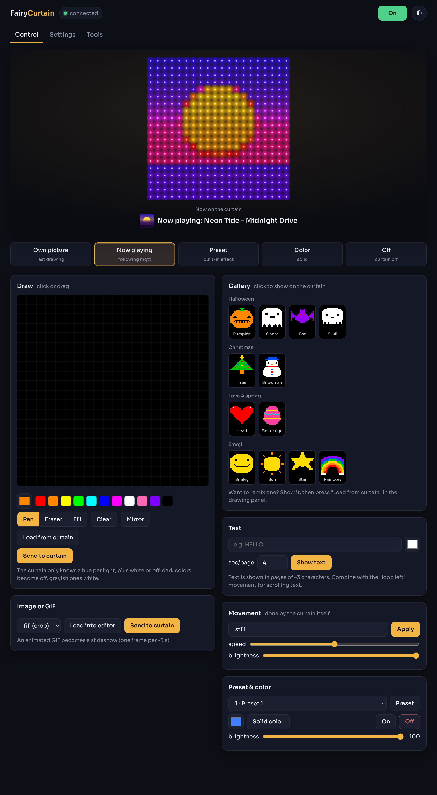
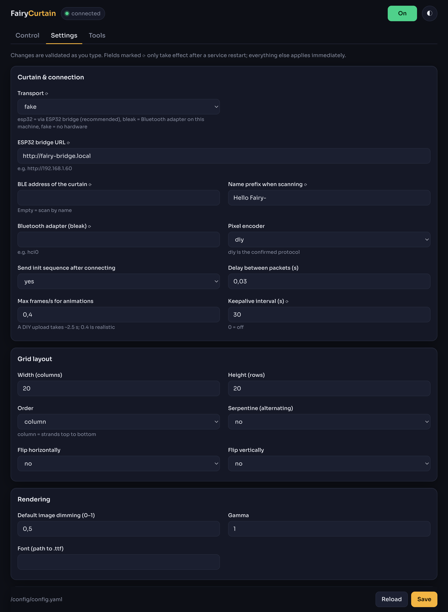

# FairyCurtain

Control your **Hello Fairy** LED curtain (Bluetooth, controller KR-026) yourself: REST API, a web admin with a pixel editor, images/GIFs/scrolling text, **album art of whatever is playing**, and a ready-made Home Assistant integration via MQTT.

```
┌──────────────┐  HTTP/MQTT  ┌──────────────┐   BLE    ┌──────────────┐
│ HA / your    │ ──────────▶ │ FairyCurtain │ ───────▶ │ Hello Fairy  │
│ apps / UI    │             │  (Python)    │          │  curtain     │
└──────────────┘             └──────┬───────┘          └──────────────┘
                                    │  or via HTTP to an ESP32 bridge
                                    └──────▶ ESP32 (fairy_bridge.ino) ──BLE──▶ curtain
```

> Unofficial, community project. Not affiliated with or endorsed by Hello Fairy.

## Screenshots

**Control**: the curtain live (here showing album art from the now-playing source), pick what it shows, draw pixel art, send images/GIFs/text, set movement.



**Settings**: every `config.yaml` option in the browser, validated as you type; secrets are masked.



The album cover in the first screenshot is a generated example image.

## What's inside

| Component | Path |
|---|---|
| Protocol (packets, checksum, pixel encoders) | `fairycurtain/protocol.py` |
| Grid ↔ pixel index (layout, calibratable) | `fairycurtain/layout.py` |
| Image/GIF/text → 20×20 frames | `fairycurtain/render.py` |
| Connection, state, animations | `fairycurtain/device.py`, `transport.py` |
| REST API + web admin | `fairycurtain/api.py`, `static/index.html` |
| Now playing (album art from any source) | `fairycurtain/nowplaying.py` |
| Built-in gallery (Halloween, Christmas, emoji, …) | `fairycurtain/gallery.py` |
| Config validation + in-browser config editor | `fairycurtain/config_schema.py` |
| MQTT + HA discovery | `fairycurtain/mqtt.py` |
| ESP32 bridge firmware (optional) | `esp32-bridge/fairy_bridge.ino` |
| App sniffer to verify the pixel protocol | `tools/btsnoop_writes.py` |
| HA examples | `homeassistant/examples.yaml` |

## Quick start

```bash
cp config.example.yaml config.yaml      # edit to taste
pip install .                           # or: docker compose up -d --build
fairycurtain                            # http://localhost:8321
```

Open `http://<host>:8321` for the admin page, `http://<host>:8321/docs` for the API documentation.

**Important:** the curtain accepts only one Bluetooth connection. Close the Hello Fairy app on your phone (or turn Bluetooth off there) before starting the service.

## Where does it run? Two options

**A. Direct (transport: `bleak`)** — the service runs on a machine with a Bluetooth adapter, within roughly 5–8 m of the curtain. On Proxmox: pass a USB BT dongle through to the LXC/VM running Docker (`network_mode: host` + D-Bus, see `docker-compose.yml`). Or use a Raspberry Pi.

**B. Via ESP32 (transport: `esp32`)** — flash `esp32-bridge/fairy_bridge.ino` onto an ESP32 (fill in your Wi-Fi credentials; install NimBLE-Arduino). Place it near the curtain, set `transport: esp32` and `bridge_url: http://fairy-bridge.local` in `config.yaml`. The service can then run anywhere in your network without Bluetooth. This is usually the most convenient option.

## API overview

All endpoints live under `/api` and speak JSON. With `api_key` set, send the header `X-API-Key`. Full, interactive documentation is at `/docs`.

| Endpoint | Purpose | Example body |
|---|---|---|
| `GET /status` | state/connection | |
| `POST /power` | curtain on/off (master switch untouched) | `{"on": true}` |
| `POST /master` | master switch: off = everything off and now playing paused | `{"on": true}` |
| `POST /color` | solid color | `{"hex":"#ff8800","brightness":60}` or `{"r":255,"g":0,"b":0}` |
| `POST /brightness` | brightness 0–100 | `{"brightness": 40}` |
| `POST /preset` | built-in effect 1–58 | `{"preset": 20}` |
| `POST /frame` | custom grid | `{"hex": ["#ff0000", … 400×]}` or `{"pixels": [[[r,g,b],…],…]}` |
| `POST /image` | multipart upload (PNG/JPG/GIF) | fields `file`, `fit`, `brightness` |
| `POST /image/base64` | image as base64 | `{"data":"…","fit":"cover"}` |
| `POST /text` | text in pages | `{"text":"Hi","color":"#00ffff","page_seconds":4,"movement":"loop_left"}` |
| `GET /gallery`, `POST /gallery/{id}` | list the built-in pictures / show one | |
| `POST /movement` | move/blink/breathe the picture | `{"direction":"loop_left","speed":40,"brightness":80}` |
| `POST /animation/stop` | stop animation | |
| `POST /clear` | all black | |
| `GET /frame/preview.png` | last shown frame as an image (as the curtain shows it) | |
| `GET /frame` | last sent frame as a hex list | |
| `GET /nowplaying`, `POST /nowplaying/enable`, `POST /nowplaying/push` | now playing status, on/off, push from your own app | `{"artist":"…","title":"…","image":"https://…"}` |
| `GET/PUT /config`, `POST /config/validate`, `POST /restart` | read/validate/save the config, restart the service | |
| `POST /test/pixel` | one physical LED (calibration) | `{"index": 0}` |
| `PUT /layout` | adjust/save grid mapping | `{"width":20,"height":20,"order":"column","serpentine":false}` |
| `POST /raw` | raw bytes | `{"hex":"aa020101ae"}` |

```bash
curl -X POST localhost:8321/api/text -H 'Content-Type: application/json' \
     -d '{"text":"Welcome!","color":"#ff66cc","speed":14}'
curl -X POST localhost:8321/api/image -F file=@pumpkin.gif -F brightness=0.4
```

## Gallery: ready-made pictures

The Control page has a gallery of 20×20 pixel-art pictures to show with one click, like the official app: **Halloween** (pumpkin, ghost, bat, skull), **Christmas** (tree, snowman), **Love & spring** (heart, Easter egg) and **Emoji** (smiley, sun, star, rainbow). Over the API:

```bash
curl localhost:8321/api/gallery                       # list: id, title, category, 400 hex colors
curl -X POST localhost:8321/api/gallery/pumpkin       # show one on the curtain
```

Pictures are scaled to other layout sizes automatically. To add your own, add a sprite to `fairycurtain/gallery.py` (a few lines of text per picture; see the existing ones), or just draw one in the editor and send it. Remember the curtain shows one hue per pixel, so saturated colors work best.

## Now playing: album art of what is playing

Turn on the `nowplaying` section in `config.yaml` (or use the config editor on the admin page). FairyCurtain follows a music source and shows the album art, and/or artist and title, whenever the track changes. **Any API can be the source**, as long as it returns JSON. Three source types:

- **http**: the service polls a JSON endpoint of your own app or any music API and extracts title/artist/cover with simple paths such as `track.cover_url` or `items[0].image`.
- **homeassistant**: a `media_player` entity (Spotify, Sonos, …) via the HA API with a long-lived token; the cover comes from `entity_picture`.
- **mqtt**: JSON messages on a topic (for example from HA or Node-RED).

Or let your app push instead, so nothing needs to be polled:

```bash
curl -X POST localhost:8321/api/nowplaying/push -H 'Content-Type: application/json' \
     -d '{"artist":"New Order","title":"Blue Monday","image":"https://…/cover.jpg"}'
```

`show: both` shows artist/title as text pages first and then the cover; `movement: loop_left` makes the cover scroll; `idle: off` turns the curtain off when nothing is playing. Expectation: at 20×20 with a single hue per pixel, a cover becomes a color abstraction, often recognizable by its color areas rather than by detail.

The same pattern works for anything else that can produce an image or text: weather icons, calendar reminders, build status, and so on. Any script can post to `/api/image` or `/api/text`.

## Home Assistant

Set `mqtt.enabled: true` in `config.yaml` with your broker. Through MQTT discovery a device **LED curtain** appears automatically with:

- `light.led_curtain` – on/off, RGB color, brightness, effect list (the 58 presets);
- `text.led_curtain_text` – type text in HA and it is shown on the curtain;
- `button.led_curtain_stop_animation`.

For automations there are command topics (`fairycurtain/cmd/text`, `/cmd/image`, `/cmd/frame`, `/cmd/raw`, `/cmd/stop`). Without MQTT everything also works with `rest_command`. Both are worked out in `homeassistant/examples.yaml`.

## First run: calibration

1. Start the service, open the admin page and check the status says "connected".
2. Click **On**, pick a solid color. If that works, the basics (confirmed protocol) are fine.
3. **Calibration**: click "Light up" at index 0, then ▶ for 1, 2, 3 … and watch which LEDs light up:
   - first strand runs top to bottom → `order: column`;
   - second strand starts at the bottom → `serpentine: true`;
   - first strand on the right → `flip_x`; index 0 at the bottom → `flip_y`.
4. Save. Draw something asymmetric (an arrow) and check it.

## Pixel protocol (confirmed)

The per-pixel protocol comes from a Bluetooth capture of the official app plus the APK, worked out by **kmich** (fork of `nzrutman/hello_fairy_ble`, branch `curtain-studio-rc5`, `PROTOCOL.md`) and physically confirmed on a 20×20 curtain. Quirks you'll notice in practice:

- The curtain knows only a **hue** per pixel (0–180 = hue/2), plus **white** (255) and **off** (254). No per-pixel brightness or pastel; the editor turns dark colors "off" and grayish colors white. Brightness is global (under "Movement").
- An upload is exactly six packets (5×242 + 20 bytes) with fixed delays; total ≈ 2.5 s. That is why frame animation is slow (`max_fps: 0.4`). Moving, blinking and breathing a picture is done by the curtain itself (`POST /api/movement`), without a new upload.
- Index = column × 20 + row (strands top to bottom): the default layout. The curtain reports its own dimensions (`info` in `/api/status`).

The old guesses remain as `legacy_*` encoders; the curtain ignores them. `tools/btsnoop_writes.py` is still handy for discovering new commands yourself (music mode, timers and the two-picture animation are described in kmich's `PROTOCOL.md` and are a logical next extension).

## Limitations

- Uploading a full picture takes ≈ 2.5 s. Text is therefore shown in pages of ~3 characters; GIFs become a slideshow. For motion, use the curtain's built-in movements.
- One hue per pixel: photos get "posterized". Pixel art, icons and text look good.
- One connection at a time: the phone app and this service cannot be used together.
- The IR remote keeps working; state changes from it arrive as notifications and are passed on to HA.

## Development / testing

```bash
pip install -e ".[dev]"
FAIRY_TRANSPORT=fake fairycurtain        # run without hardware
pytest
```

## Security note

By default the API listens on `127.0.0.1` only. The Docker image binds `0.0.0.0` (so the published port works); there, and whenever you set `api.host: 0.0.0.0`, also set `api.api_key` (or `FAIRY_API_KEY`) — a warning is logged otherwise. Do not expose port 8321 to the internet, preferably put it behind a reverse proxy with TLS. Without an `api_key`, requests whose `Host` is a name other than `localhost` or an entry in `api.allowed_hosts` are refused (DNS-rebinding protection; plain IP access works), and cross-origin write requests from browsers are refused. Image URLs fetched by the service (MQTT `cmd/image`, now playing covers) are limited to http(s), non-loopback/link-local hosts, 5 MB and 10 s. Anyone who can publish to your MQTT broker can control the curtain, so secure the broker. `config.yaml` may contain tokens (HA token, MQTT password, API key); it is git-ignored, and the config editor masks secrets.

## License

[MIT](LICENSE)
